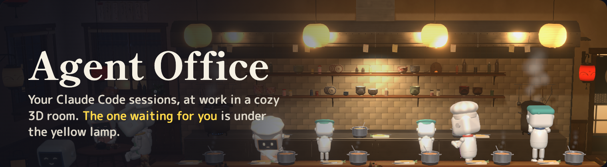
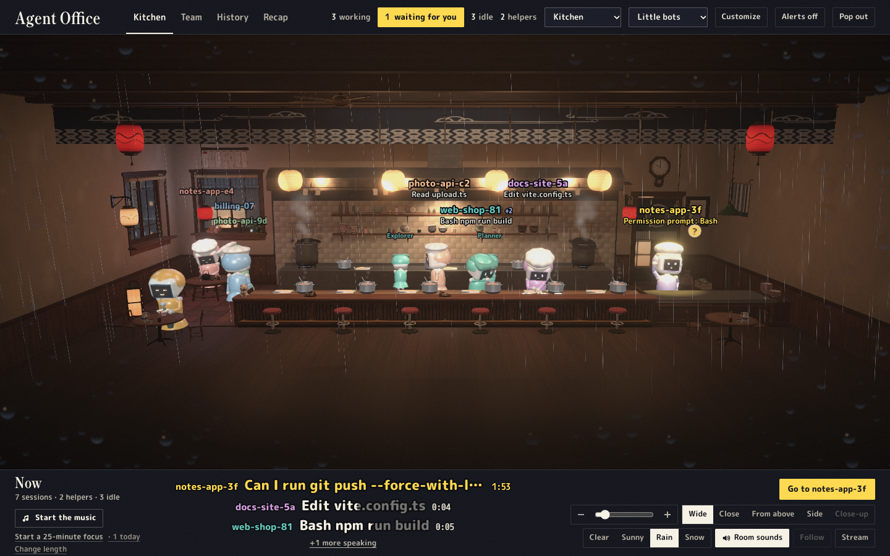
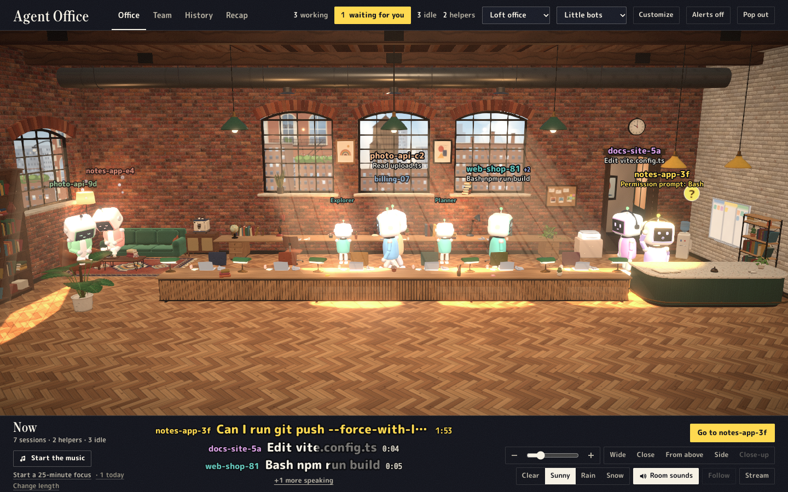
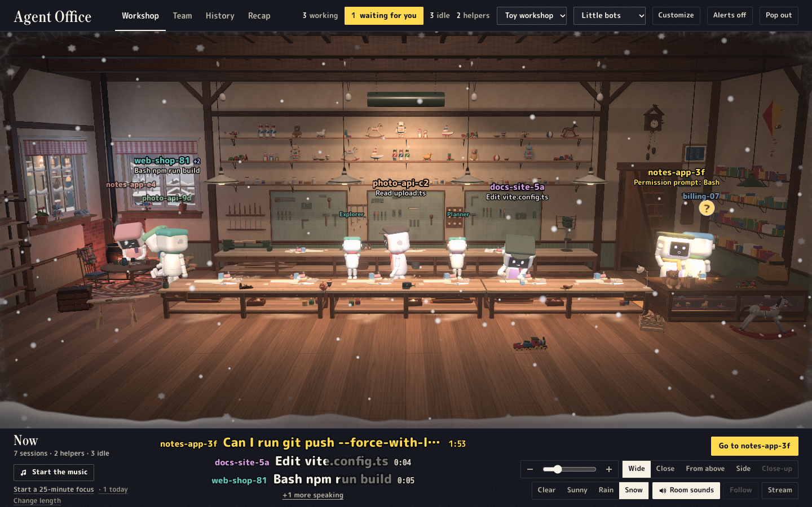
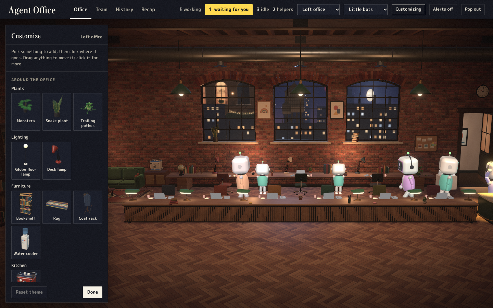
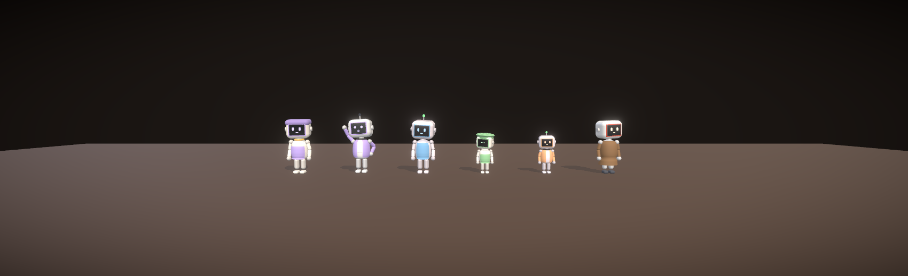
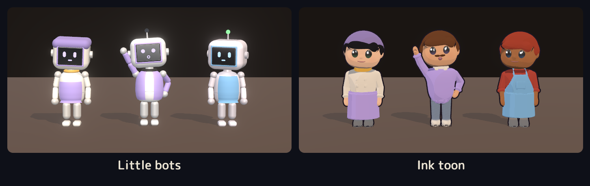
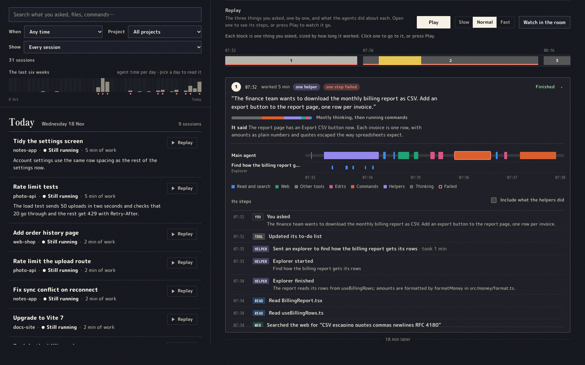

<h1 align="center">
  
</h1>

<div align="center">


</div>

<div align="center">
<a href="#features">✨ Features</a> • <a href="#getting-started">🚀 Getting started</a> • <a href="#the-themes">🏠 Themes</a> • <a href="#weather">🌧️ Weather</a> • <a href="#customizing-the-room">🪴 Customize</a> • <a href="#how-it-works">⚙️ How it works</a> • <a href="#testing">🧪 Testing</a> • <a href="#troubleshooting">🛠️ Troubleshooting</a>
</div>

<br/>

Agent Office turns the Claude Code sessions running on your computer into little people at work in a
cozy 3D room at night: a loft office, a ramen kitchen or a toy workshop. Each session is one
person. They act out what the session is doing (typing when it edits, reading when it reads,
stirring the pot when it runs a command), walk off to the printer or the lathe when a command runs
long, and when a turn ends they finish it the theme's way: the cook serves the dish to a customer,
the office moves its note to "Done", the toymaker carries the toy to the shop counter. The one
waiting for you steps under a yellow lamp with a "?". Subagents work beside them as small helpers.

It reads the files Claude Code already writes on your computer. It installs nothing into Claude
Code, adds no hooks, never changes your settings, and serves on 127.0.0.1 only. Use it as a panel in
VS Code or Cursor, or in your browser with one `npx` command ([Getting started](#getting-started)).



| Loft office, on a sunny day | Toy workshop, in the snow | Customize |
|---|---|---|
|  |  |  |

## Features

- **One session, one person**: the same person every time, with the session's colour on their apron
  or sweater and its name over their head; each working helper's small tag says its task (or a
  teammate's name) and whose helper it is ("Explorer for web-shop-81"), and a faint dotted line runs
  from it to that session's tag, lit up while you point at either or have the session selected.
  Resting the pointer on a helper's tag tells the step it's on and for how long.
- **Two ways to draw them**: "People" in the top bar picks little bots (whose screen faces show
  what they're doing: blinking at work, dots while thinking, a smile on a break, round eyes and a
  yellow light when they need you, asleep when idle) or ink toon (cel shading with an ink outline).
  Both dress for the weather and do the same things.
- **Live activity**: what they do follows the session's current tool, and "thinking" keeps them
  busy (tasting, sanding, jotting notes) instead of standing still.
- **Three themes that play differently**: each has its own places and routines, not just its own
  furniture ([the themes](#the-themes)).
- **Weather everywhere**: a clear night, a sunny day, rain or snow over the whole picture, and the
  people dress for it: rain jackets with the hood down, knitted scarves and pompom beanies, umbrellas
  at the door, a hot drink in both hands when it snows, an iced one in the sun, and customers in
  sunglasses and straw hats.
- **People use the room**: on a break, the idle walk over to what you've added (a coffee, the water
  cooler, the bookshelf, a plant, the radio, a toy); a stool is one more seat; a long stretch of
  reading sends a worker to the bookshelf. They walk around everything, and Customize keeps the
  walkways clear.
- **Waiting for you**: a yellow lamp, a "?", a yellow caption, the tab title, an optional desktop
  alert, and a button that brings that session's terminal to the front.
- **Customize**: add plants, lamps, lanterns, toys and more; each theme keeps its own arrangement.
- **History, Recap and Team**: a diary of past sessions with a replay chart of how the agent and its
  helpers worked (who did what when, waits for you, what failed and why, step by step), which also
  plays back in the room; a digest in plain words where each model's cost opens to show what it was
  used for; and a lane view of a session and all its helpers.
- **Captions, music and focus**: live subtitles for every busy session, a lofi generator that runs
  on your computer or your own YouTube or Spotify playlist, a focus timer you set the length of, and a
  switch for the room's sounds.
- **Fast and private**: about a second to open, instant to come back to from another tab, smooth on
  big screens and busy machines, no network use, nothing real shown in `?demo` screenshots.

<p align="center">
  
</p>
<p align="center">
  
</p>

## Requirements

- [Claude Code](https://docs.anthropic.com/en/docs/claude-code), used in any terminal
- VS Code 1.85 or newer, or Cursor (or another editor that installs from Open VSX), for the
  extension; or Node.js 18.18 or newer for `npx`
- A browser with WebGL 2; it's built and tested with Google Chrome (Pop out needs Chrome)
- Built and tested on macOS. Linux and Windows should work, except "Answer in terminal", which uses
  macOS Terminal.

## Getting Started

### In VS Code or Cursor

Install **Agent Office** from the
[VS Code Marketplace](https://marketplace.visualstudio.com/items?itemName=hieuv0711.cozy-agent-office-claude)
or [Open VSX](https://open-vsx.org/extension/hieuv0711/cozy-agent-office-claude) (Cursor,
VSCodium, Windsurf). Then open the **Agent Office** tab in the bottom panel, beside Terminal: the room
alone, with its name tags and a small bar ("More" opens the whole app in place). For everything at
once, run **Agent Office: Open the Room in an Editor Tab** from the Command Palette. Start Claude Code
in any terminal, this editor's included, and someone walks in within a second.

### In your browser

```sh
npx cozy-agent-office-claude
```

It serves the room on http://127.0.0.1:4777 and opens it in your browser. To keep it around, install
it once with `npm install --global cozy-agent-office-claude` and run `cozy-agent-office-claude`.

| Option | What it does |
|---|---|
| `--port 4778` | Serves on another port (also `AGENT_OFFICE_PORT=4778`) |
| `--no-open` | Doesn't open the browser |
| `--version`, `--help` | Prints the version, or the options |

Address options, for OBS or screenshots: `?world=office` (or `kitchen`, `workshop`) picks the
theme, `?weather=snow` (or `clear`, `sunny`, `rain`) the weather, `?stream` opens in Stream mode,
`?bare` hides every overlay, and `?demo` fills the room with made-up sessions (four of them loop
through a working day, so every routine shows within a minute or two) so nothing real is shown.

## The Themes

Pick one in the top bar. Every session keeps its work spot; what they do depends on the theme.

| When a session is | In the night office | In the ramen kitchen | In the toy workshop |
|---|---|---|---|
| Editing files | types on their laptop | chops a carrot | saws a plank |
| Reading | reads a printout | reads an order ticket | reads the blueprint |
| Running a command | watches it run; if it runs long, waits at the printer (it prints) | stirs the pot; if it runs long, ladles the big broth pot | hammers the toy; if it runs long, works the lathe (it spins) or the drill press |
| On the web | is on the phone | leafs through the recipe book | digs in the parts tray; a long search, browses the shelves |
| Planning | sketches on the task board | | |
| Thinking, or anything else | chin on hand, jots notes, sips coffee; a long think, to the board or the espresso machine | tastes, shakes out noodles, wipes down | turns a toy over, sands, measures |
| Finishing a turn | walks to the task board and moves their note to "Done" | plates the dish, then carries it round to the customer who came in for it | carries the finished toy to the shop counter |
| Waiting for you | at reception, under a yellow lamp, with a "?" | at the pass, the same | at the shop counter, the same |
| Idle | coffee on the lounge sofa, then a nap | tea at the staff table, then a nap | cocoa by the stove, then a nap |
| Using helpers | interns with clipboards at the back desk | apprentices whisking at the back line | apprentices painting at the paint table |
| Starting or ending | comes in by the door, or leaves by it | the same | the same |

- **Loft office**: a brick loft with arched windows over the city. The task board on the right
  wall shows a note for everyone working and a yellow one for everyone waiting on you; the day's
  "Done" notes stay up until midnight.
- **Ramen kitchen**: only the cooks work here. Nobody else is in the room until a dish is ready;
  then a customer comes in from the street, in their own street clothes (and an umbrella when it
  rains), sits at the little table by the counter, is served by the cook, eats, and goes home. If
  both seats are taken, the dish waits on the ledge to go.
- **Toy workshop**: a toymaker's workshop with a wood stove, shelves of toys and a shop counter
  where the day's four newest toys wait to be collected.

## Weather

Clear, Sunny, Rain or Snow, in the top bar's Weather choice; one setting for every theme. It changes
the whole picture and the people in it:

- **Clear**: a clear night, the moon and the city lights outside.
- **Sunny**: daytime. Sunlight comes in through the windows and lies in warm patches on the floor;
  the idle sip iced drinks, and customers come in in shirts, sunglasses and straw hats.
- **Rain**: rain falls across the view and drops run down the edges of the glass you look through;
  the room turns cooler and dimmer. Everyone wears a rain jacket in their own colour, hood down;
  people coming in or leaving put an umbrella up at the door.
- **Snow**: snow drifts across the view, frost creeps in from the corners, snow settles on the sills,
  and the light turns bright and cool. Everyone wears a knitted scarf, a beanie if they have no work
  hat, and the idle ones hold a hot drink in both hands.

Changes fade over a few seconds. With the sound on, you hear it too; "Room sounds" by the camera
buttons turns the rain, wind and street sounds off (the music has its own switch).

## Customizing the Room

"Customize" in the top bar opens a panel of things to add: plants, lamps, a bookshelf, a whiteboard
and an espresso machine in the office; lanterns, menu plaques, bottles, crates and stools in the
kitchen; a rocking horse, toy trains, a kite and a sawhorse in the workshop.

- Pick something, then click where it goes. It only lands where it belongs (a desk, counter or bench
  top, a shelf, the sill, the floor or the wall), and everyone's own work spot stays clear.
- Drag anything to move it. Click it for Turn, Smaller, Bigger, Duplicate and Remove (keys: `R` and
  `Shift+R` turn, `[` `]` resize, `D` duplicates, `Delete` removes, `Esc` lets go).
- Each theme keeps its own arrangement in this browser; "Reset theme" puts it back as it came.
- People use what you add: the idle take breaks at it, a stool is an extra seat, and the bookshelf,
  the whiteboard, the sawhorse or the tool chest draw whoever does that kind of work for a while.
  Floor furniture can't go where people walk (the panel says so); they walk around everything else.

## On Screen

- **Tooltips**: rest the pointer on any control (the weather, Room sounds, the camera shots, the
  counts, the focus timer) or tab to it for a short explanation and its key. Escape puts it away.
  History, Recap, the Team view, the card and Customize explain themselves the same way.
- **Captions**: the lower rail subtitles every busy session, waiting ones first in yellow. A line
  fills like karaoke against how long that kind of work usually takes in that session.
- **Answer in terminal**: the yellow button brings the waiting session's Terminal tab to the front.
  The first time, macOS asks whether Agent Office (node) may control Terminal; allow it under System
  Settings > Privacy & Security > Automation.
- **Scene card**: Overview, Timeline, Subagents and Tokens for the selected session, with "Open its
  terminal" and "Copy resume command".
- **Camera**: Wide, Close, From above, Side and Close-up; zoom, Follow and Stream (a slow cinematic
  drift). It stays in front of the room, and each theme remembers the angle you left it at. Keys:
  `+` `-` zoom, `0` wide, `1`-`5` shots, `F` follow, `S` stream, `Esc` deselect. Double-click someone
  for a close-up.
- **Music and sound** (off until you press "Start the music"): a lofi generator that runs on your computer,
  or your own music: "Your music" (or the sliders button once it plays) takes a YouTube video or
  playlist, or a Spotify song, album or playlist, from its Share link (needs internet). Spotify plays
  in its own player, with its own buttons: whole songs when you're signed in to Spotify in the
  browser, 30-second previews when you're not. Soft sounds when a session starts waiting, arrives or
  leaves.
- **Focus**: "Start a 25-minute focus" for a focus stretch and a break; "Change length" sets both
  (15 to 60 minutes, or your own).
- **Pop out**: a small always-on-top roster (Chrome's Picture-in-Picture).
- **History**: a diary, a page per day, with six weeks of activity at a glance. A session's page
  says in short what happened and what went wrong, and its replay is told one request at a time: a
  card for each thing you asked (how long it worked, what it mostly did, its helpers, waits and
  failures, what it answered), a strip of all of them to jump between, and for the one you open a
  small timeline of the main agent and its helpers with its steps in words. Play goes request by
  request at a pace you pick (Slow, Normal, Fast), and "Watch in the room" acts it out in the room
  with a bar saying which request it is, what you asked and what it's doing. Search what you asked,
  files and commands; tokens and cost wait in a folded "Numbers" section.

<p align="center">
  
</p>

- **Recap**: a digest in plain words for today, yesterday, this week, the last 7 days or this month.
  Under "Numbers", each model's cost opens to show the sessions, projects and kinds of tokens it went
  on, day by day.
- **Team**: one session's main agent and every helper as lanes over time.

## How It Works

- The server (`server/`, plain Node, no dependencies) reads `~/.claude/sessions/<pid>.json` for live
  status and `~/.claude/projects/**` for transcripts, subagents and Workflow runs, read-only. It
  writes only inside `~/.agent-office/` (a summary per session, so History survives Claude Code's own
  cleanup). It pushes the live office to the page over server-sent events.
- The page (`web/`, React, three.js and react-three-fiber) draws the room and its people. The people
  are sculpted from signed distance fields and posed by their hands (a two-bone solver bends the
  arms to reach); a theme is a floor plan, a kit of acts and props, its places and routines
  (`web/src/tide/crew/`, `kitchen/`, `office/`, `workshop/`).
- The rooms are generated in code. The first time a theme opens, the browser builds it (3 to 5
  seconds) and keeps the result in its own storage for this site (about 160 MB for all three themes);
  later opens take about a second. The saved copies belong to the code that drew them: an update
  that doesn't change the rooms or the people keeps them, one that does builds them again once.
  Switching to History and back keeps the room as it is (it just stops drawing meanwhile).
- Where people can walk is drawn once from above (everything between ankle and chest height is in
  the way); routes to the things you add go around it all (`web/src/tide/crew/walkmap.ts`).
- To stay smooth: edges are smoothed with SMAA rather than multisampling; once a room has settled,
  everything in it that never moves is merged into one draw call per material (`web/src/tide/batch.ts`);
  shadows are redrawn every other frame and tiny objects cast none; the weather on the glass is drawn
  at half resolution; faraway people use a lighter model; and the picture draws at most about three
  million pixels. If frames come too slowly and the pixels are the cause, the resolution steps down
  until they don't, and back up when there's room. On the Mac it was built on, at 2560 wide with the
  frame-rate cap off, that took the rooms from 50 to 70 frames a second to 95 to 120.
- Numbers are honest by construction: every API message is counted once (summing every transcript
  line would show 2.5 to 4 times too many tokens), and cost uses API list prices.

| Variable | Default | Meaning |
|---|---|---|
| `AGENT_OFFICE_PORT` | `4777` | Port (always bound to 127.0.0.1) |
| `CLAUDE_CONFIG_DIR` | `~/.claude` | Extra Claude Code config folder to read |
| `AGENT_OFFICE_CLAUDE_DIRS` | | More folders, comma separated (one per login) |
| `AGENT_OFFICE_HOME` | `~/.agent-office` | Where summaries and session numbers are kept |

## Development

To work on it, clone the repository and `npm install` (Node.js 20 or newer). The server itself has
no dependencies; the web app is built with Vite into `dist/`.

| Command | What it does |
|---|---|
| `npm start` | Serves the built app on http://127.0.0.1:4777 (`npm start -- --open` opens it too) |
| `npm run build` | Builds the web app into `dist/` |
| `npm run dev:server` + `npm run dev:web` | Live-reload development on http://localhost:5173 |
| `npm run typecheck` | TypeScript check of the web app |
| `npm run test:e2e` | The end-to-end tests ([Testing](#testing)) |
| `npm run selftest` | Compares the token and cost totals with Claude Code's own cost records |
| `npm run build:vscode` | Packs the VS Code / Cursor extension (`vscode/`) into a `.vsix` |

- `npm run dev:server` and `npm run dev:web` give live reload on http://localhost:5173.
- Preview pages: `?proto=crew&theme=kitchen|office|workshop|diner&acts=chop,stir` (people in a row,
  one per act), `?proto=crew&cast=chef:stand,office:wave,diner:umbrella` (the whole cast),
  `?proto=ramen`, `?proto=office-room`, `?proto=workshop-room`.
- `?people=bots|toon` picks how the people are drawn for one visit (without saving it).
- Test hooks (development, or `?test` on the built app): `window.__crew` (each person's act, place
  and clothes), `window.__dining` (customers and dishes), `window.__ao` (scene, camera, controls,
  renderer), `window.__walkmap` (the walk map, and the things people use), `window.__batch` (meshes
  merged). `?breaks=0` keeps the idle in their seats. People are
  groups named `person:<outfit>` with meshes named `torso:<garment>`, `hood`, `scarf`, `beanie`,
  `hat:<kind>`. `?cachecheck` rebuilds every saved piece of the room and compares it with the saved
  copy (`window.__cacheCheck`). For measuring: `?fx=0`, `?msaa=4`, `?aa=fxaa`, `?bloom=0`,
  `?batch=0`, `?glass=0`, `?front=0` switch parts of the picture off.

## Testing

The test plan is [docs/test-scenarios.md](docs/test-scenarios.md): about a hundred scenarios
across the app shell, the people, weather, camera, selection, Customize and the furniture people
use, History, Recap, Team, the caption rail, layout, speed, accessibility, edge cases and privacy.
Each one has a Playwright test in `tests/e2e/` named after its ID.

```sh
npm install
npm run test:e2e                              # every scenario, against http://127.0.0.1:4777
npx playwright test tests/e2e/weather.spec.ts # one area
AO_E2E_ORIGIN=http://localhost:5173 npm run test:e2e   # against another server (the dev one)
npx playwright show-report                    # the last run, with screenshots
```

The tests use the installed Google Chrome with its GPU (`--use-angle=metal`; the software renderer
can't draw the scene), reuse the running server, and turn on the test hooks with `?test`.

## Troubleshooting

| Problem | Fix |
|---|---|
| `Port 4777 is busy` | `npx cozy-agent-office-claude --port 4778` |
| The room is empty | Start Claude Code in any terminal; someone walks in within a second |
| It takes a few seconds to open | Only the first time each theme opens after an update; then about a second |
| It stutters | Other heavy work on the computer (file syncing, a VM, many browser tabs) shares the GPU; the picture lowers its resolution on its own when that helps |
| The extension's panel says the room's server stopped | Agent Office: Show the log (the Output panel's "Agent Office"): usually no Claude Code data was found yet; start Claude Code once |
| A page saying the web app is not built | Only in a checkout of the source: `npm install && npm run build` |
| The 3D view is blank | The browser needs WebGL 2 and its GPU; try Chrome |
| "Answer in terminal" says macOS blocked it | Allow it under System Settings > Privacy & Security > Automation |

## Privacy

Everything stays on this computer: the server (the extension starts the same one) listens on
127.0.0.1 only and rejects other Host headers,
the page makes no requests to other sites (except the YouTube or Spotify player, if you paste a link), and
`?demo` shows made-up sessions only, for screenshots you can share.

## Docs

- [PRODUCT.md](PRODUCT.md): who it is for and what it must do
- [docs/DESIGN.md](docs/DESIGN.md): screens, behaviour, architecture, how each number is computed
- [docs/test-scenarios.md](docs/test-scenarios.md): the test plan
- [docs/PAIN_POINTS.md](docs/PAIN_POINTS.md): what users of other agent visualizers complain about
- [CONTRIBUTING.md](CONTRIBUTING.md): building it, the tests, and publishing

## Contributing

Issues and pull requests are welcome. [CONTRIBUTING.md](CONTRIBUTING.md) says how to build it from
source, run the tests and keep the rooms' saved pieces valid.

## License

[MIT](LICENSE). Agent Office is not affiliated with Anthropic; Claude and Claude Code are
Anthropic's.
