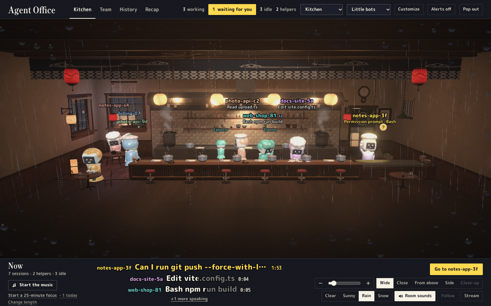

# Agent Office

Your Claude Code sessions as little people at work in a cozy 3D room: a loft office, a ramen
kitchen or a toy workshop. Each session is one person who acts out what it's doing (typing when it
edits, reading when it reads, stirring the pot when it runs a command). The one waiting for you
steps under a yellow lamp with a "?", and its helpers work beside it.

## Use it

- Open the **Agent Office** tab in the bottom panel (beside Terminal): the room alone, with its name
  tags and a small bar; **More** opens the whole app in place, **Room only** goes back.
- **Agent Office: Open the Room in an Editor Tab** (Command Palette) opens the whole app in a tab:
  History, Recap, the theme, the weather, the music and the camera.
- Start Claude Code in any terminal, this editor's included: someone walks in within a second.
- **Agent Office: Open the Room in the Browser** shows the same room in your browser.
- Pick the room, the weather and how the people look in its top bar; History replays past
  sessions request by request.

## Private by design

It reads the files Claude Code already writes on this computer (`~/.claude`), installs nothing into
Claude Code (no hooks, no settings changed), and serves on 127.0.0.1 only. The page makes no
requests to other sites unless you paste a YouTube or Spotify link for music.

## Requirements

- Claude Code, used in any terminal.
- Built and tested on macOS. Linux and Windows should work, except "Answer in terminal", which uses
  macOS Terminal.

## Settings

- `agentOffice.port`: the port of the room's local server on 127.0.0.1 (0 picks a free one).

More on the [project page](https://github.com/hieuv0711/cozy-agent-office-claude). MIT licensed.
Not affiliated with Anthropic; Claude and Claude Code are Anthropic's.
